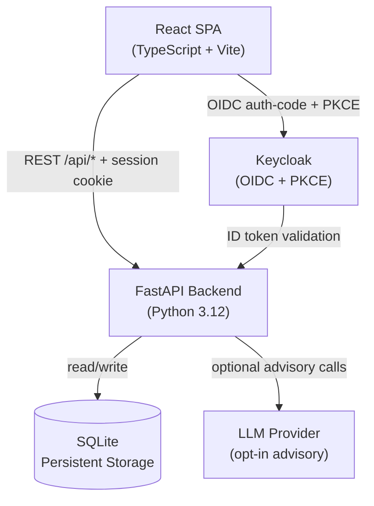

# AI Security Operations Center | Alan Vo | AI & Machine Learning

> Work in progress. This checkpoint may be incomplete or fail tests. See PLAN.md and STATUS.md before use.


An AI-powered security operations platform that addresses the core problem of alert fatigue and slow incident response in enterprise security teams. The system applies **deterministic threat scoring algorithms** to ingested security events, auto-correlates related events into incidents by asset and event type, and provides optional LLM-assisted root-cause analysis grounded in actual threat records.

**Intended users:** Security analysts and operators who need a real-time, auditable view of threat activity without relying on a large-language model for every decision.

---

## AI/ML Evaluation

**Approach:** The threat scoring engine applies a severity-weighted formula augmented by event-type-specific boosts. This is a deterministic, reproducible baseline that works offline without any LLM key.

```bash
# Run the scoring baseline locally
cd /path/to/repo
python3 -m venv .venv && .venv/bin/pip install -r backend/requirements.txt -q
PYTHONPATH=backend DATABASE_URL="sqlite:///:memory:" DEMO_MODE=true \
  .venv/bin/python -m pytest backend/tests/ -v
```

**Data provenance:** All tests use synthetic in-memory data generated at runtime. No external datasets required.

**Baseline:** Score formula — `min(100, severity_base + event_type_boost)` where:
- `critical=90`, `high=70`, `medium=45`, `low=20`
- boosts: `exfiltration+12`, `intrusion+10`, `malware+8`, `lateral_movement+7`

**Measured results (30 tests, 0.66s):** All pass; exfiltration+critical correctly caps at 100.0; correlation correctly groups same-asset events.

**LLM advisory layer (opt-in):** When `LLM_API_KEY` is set, the system sends grounded prompts (actual incident/threat data) to the configured provider for root-cause hypothesis and NL query translation. Without a key, the NL query endpoint falls back to keyword-based deterministic parsing. LLM responses are labeled advisory in the UI.

**Failure cases and limitations:** Correlation uses asset-name and event-type matching; sophisticated attackers using different asset aliases or novel event types will not be grouped. Scoring does not model time-decay or inter-event relationships. LLM analysis quality depends on the configured provider and prompt quality.

---

## Architecture



---

## Features

- **Threat ingestion and scoring:** POST `/api/threats` — deterministic severity × event-type score, persisted to SQLite with raw data and audit log entry
- **Incident correlation:** Auto-groups related threats by asset name and event type into incidents; timeline view shows chronological event sequence
- **Asset risk scoring:** Accumulates risk score per asset from all ingested threats; displays risk level and contributing event types
- **Natural language query:** POST `/api/query` — keyword-based deterministic parsing with optional LLM translation to structured filters
- **OIDC + PKCE authentication:** Authorization-code flow via Keycloak; backend-managed sessions with HttpOnly SameSite cookies and CSRF protection
- **Role-based access control:** `viewer` (read-only), `analyst` (ingest + manage), `admin` (full access)
- **Demo mode:** Local-only (`DEMO_MODE=true`), refused at startup if not binding localhost
- **Multi-provider LLM:** OpenAI-compatible (OpenRouter/LiteLLM/Ollama), Anthropic messages API, Gemini generateContent

---

## Quick Start

### Local development (demo mode)

```bash
git clone https://github.com/ALANDVO/ai-security-ops-alan-vo.git
cd ai-security-ops-alan-vo

# Backend
python3 -m venv .venv
.venv/bin/pip install -r backend/requirements.txt
cp .env.example .env
# Edit .env: set DEMO_MODE=true for local dev without Keycloak
PYTHONPATH=backend DEMO_MODE=true .venv/bin/uvicorn app.main:app --host 127.0.0.1 --port 8000

# Frontend (separate terminal)
cd frontend
npm install
npm run dev
```

### Docker Compose (with Keycloak)

```bash
cp .env.example .env
# Edit .env: set JWT_SECRET, KEYCLOAK_ADMIN_PASSWORD, OIDC_CLIENT_SECRET
docker compose up -d
# Backend: http://localhost:8000/api/docs
# Frontend: http://localhost:3000
# Keycloak admin: http://localhost:8080
```

---

## Install & Test

```bash
# Backend tests
python3 -m venv .venv
.venv/bin/pip install -r backend/requirements.txt
PYTHONPATH=backend DATABASE_URL="sqlite:///:memory:" DEMO_MODE=true \
  .venv/bin/python -m pytest backend/tests/ -v

# Frontend build and tests
cd frontend
npm install
npm run build
npm test
```

---

## API Endpoints

| Method | Path | Auth | Description |
|--------|------|------|-------------|
| GET | `/api/health` | none | Health check |
| GET | `/api/auth/login` | none | Start OIDC login |
| GET | `/api/auth/callback` | none | OIDC callback |
| POST | `/api/auth/demo-login` | none | Demo session (local only) |
| GET | `/api/auth/me` | session | Current user |
| POST | `/api/auth/logout` | session | Logout |
| GET | `/api/threats` | viewer+ | List threats (filter: severity, source, asset) |
| POST | `/api/threats` | analyst+ | Ingest threat event |
| GET | `/api/incidents` | viewer+ | List incidents (filter: status, severity) |
| POST | `/api/incidents` | analyst+ | Create incident |
| PATCH | `/api/incidents/{id}` | analyst+ | Update incident |
| GET | `/api/incidents/{id}/timeline` | viewer+ | Incident threat timeline |
| POST | `/api/query` | viewer+ | Natural language query → filters |
| GET | `/api/stats` | viewer+ | Aggregated threat statistics |
| GET | `/api/scores` | viewer+ | Asset risk scores |

---

## LLM Provider Configuration

| Variable | Description | Default |
|----------|-------------|---------|
| `LLM_API_KEY` | API key (server-side only, never logged) | — |
| `LLM_PROVIDER` | `openai-compatible`, `anthropic`, `gemini` | `openai-compatible` |
| `LLM_BASE_URL` | Base URL for OpenAI-compatible endpoint | `https://api.openai.com/v1` |
| `LLM_MODEL` | Model name | `gpt-4o-mini` |

All LLM calls are bounded (30s timeout), grounded in actual records, and labeled advisory in the UI. The deterministic scoring engine and NL query fallback work without any LLM key.

---

## SSO / Keycloak Setup

1. Start Keycloak: `docker compose up keycloak -d`
2. The `docs/keycloak-realm.json` realm is imported automatically on first start
3. Set `OIDC_CLIENT_SECRET` in `.env` to match the client secret in the realm file
4. Set `OIDC_DISCOVERY_URL=http://localhost:8080/realms/security-ops/.well-known/openid-configuration`

**SAML upstream IdPs:** Keycloak supports SAML identity brokering. Configure an upstream SAML IdP in the Keycloak admin console under **Identity Providers → Add provider → SAML v2.0**. This application delegates SAML federation to Keycloak and uses OIDC to communicate with it.

---

## Security Notes

- Tokens are never stored in localStorage; backend sessions use HttpOnly SameSite cookies
- PKCE prevents code interception attacks
- CSRF protection on all cookie-authenticated mutations
- Demo mode is explicitly opt-in and refused in production environments
- LLM API keys are server-side only; never logged or returned to clients
- No hardcoded bypass in production; demo mode requires `DEMO_MODE=true`
- This is a portfolio application; it has not undergone a security audit

---

## Backup and Restore

```bash
# Backup SQLite database
docker compose exec backend sqlite3 /app/data/security_ops.db ".backup /app/data/backup.db"
docker compose cp backend:/app/data/backup.db ./backup.db

# Restore
docker compose cp ./backup.db backend:/app/data/backup.db
docker compose exec backend sqlite3 /app/data/security_ops.db ".restore /app/data/backup.db"
```

---

## Backend Modules

- `backend/app/core/config.py` — Environment-based configuration
- `backend/app/core/database.py` — SQLite connection management and schema init
- `backend/app/core/logging.py` — Structured logging setup
- `backend/app/api/auth.py` — OIDC PKCE auth, session management, CSRF
- `backend/app/api/routes.py` — All FastAPI route handlers
- `backend/app/api/schemas.py` — Pydantic request/response models
- `backend/app/services/detection.py` — Threat ingestion and scoring engine
- `backend/app/services/correlation.py` — Incident correlation and timeline
- `backend/app/services/scoring.py` — Asset risk score accumulation
- `backend/app/services/llm.py` — Multi-provider LLM adapter

---

Alan Vo | alanvo@gmail.com
